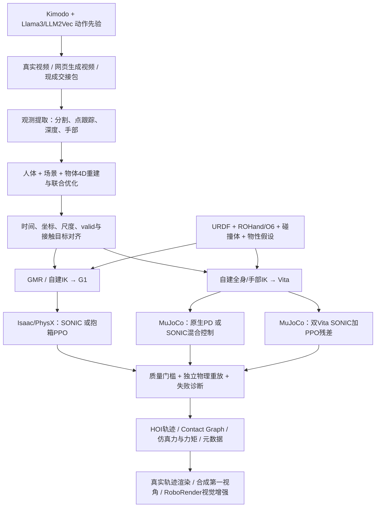

# 整套流程的模块地图与代码入口

盘点日期：2026-10-28。这里整理已经存在的代码与证据，不将不同样例的成功拼接成一个未经验证的端到端成功。

## 1. 总体数据流



现有流水线有三类入口：GRAIL官方模块、KinoGen公开组件及自建机器人任务、直接读取外部重建交接包。Open-CHOIR可在“手物重建”位置评估接入；目前仍是候选。新收到的HDMI-Vita源码属于重定向后的Isaac Lab追踪训练框架，当前只完成静态归档与接口盘点，不计入已执行物理任务。[HDMI接入盘点](HDMI_MODULE.zh-CN.md)。

## 2. 模块、入口和当前状态

下表路径均相对工作区根目录；KinoGen脚本实际在服务器 `/data/KinoGen` 运行。

| 环节 | 已有代码/资源 | 输入 → 输出 | 当前验证范围 |
| --- | --- | --- | --- |
| 来源和环境管理 | `projects/kinogen/scripts/prepare_dependencies.py`、`fetch_sources.py`、`check_setup.py`、`verify_downloads.py`；`manifests/`、`requirements-*` | 上游快照/权重 → 来源与SHA、组件环境 | 已有大量依赖快照和服务器环境；下载完整性与算法任务成功分开判定 |
| 运动/文字先验 | `projects/kinogen/scripts/smoke_kimodo.py`、`smoke_kimodo_text.py`；`dependencies/kimodo`、`weights/text-encoders` | 文字/根节点约束 → G1运动参考 | 真实采样和原版Llama3/LLM2Vec文字路径通过；不自动保证接触 |
| 视频生成/输入 | `projects/kinogen/data/video_generation/`；GRAIL `projects/grail/grail/pipelines/gen_2dhoi.py` | 首帧/提示词 → MP4 | 用户网页生成视频已接入；API后端和上游可选模型有各自访问条件 |
| 分割/跟踪 | `process_user_vision.py`、`track_user_video.py`、SAM3/TAPNet；GRAIL SAM2 | 视频 → 掩码、二维轨迹、有效性 | 用户121帧双视角实际运行；SAM3为逐帧image/eager路径，不能当官方完整video tracker验收 |
| 深度/几何 | VDA、`calibrate_user_depth.py`、`prepare_reconstruction_geometry.py`；GRAIL MoGe | 相对深度/相机 → 条件尺度与几何观测 | 有真实推理和条件校验；单目尺度及生成视频一致性仍有限 |
| 手与物体姿态 | WiLoR+MANO、`user_hand_mano.py`、FoundationPose；GRAIL相关适配 | RGB/掩码/已知物体 → 手部先验与物体候选 | WiLoR已运行；KinoGen FoundationPose证据主要为真实网络烟测，箱体主要由自建轮廓拟合 |
| 全身/HOI重建 | GRAIL `recon_4dhoi.py`、`projects/grail/optimization/hoi_optimizer.py`；KinoGen `optimize_user_*`、`export_user_full_scene_v4.py` | 人体/物体/相机观测 → 统一三维候选 | GRAIL楼梯真实路径已运行；G1视频V4仍是条件重建，保留不可靠帧 |
| G1模型与重定向 | GRAIL `projects/grail/retargeting/`、`imports/GMR`；`build_g1_five_finger.py`、`user_rohand_coupling.py` | SMPL-X/机器人观测 → G1关节、ROHand耦合 | GMR楼梯实际运行；G1五指组装和FK/单位检查通过 |
| 新增UMR重定向 | `projects/umr/scripts/humanoid_retarget_pipeline*.py`、`projects/umr/tools/two_person_baseline/` | 人体表面/场景/物体 → 表面对应、机器人运动学轨迹、接触修正与时序平滑 | 源码解包核验，283个LFS指针未补齐；带双Vita换座入口但模型为28身体关节预设，尚未与Vita52物理链集成。[接入清单](UMR_MODULE.zh-CN.md) |
| Vita原动作/短片段 | `prepare_vita_demo_inputs.py`、`render_vita_motion_demos.py`；`fourth_vita_retarget.py`、`fourth_vita_contact_slide_reference.py` | 原轨迹/SMPL-X → Vita52参考 | 17条是运动学回放；单碗接触适配有独立物理通过结果 |
| Vita全序列参考 | `fourth_full_reference.py`、`fourth_full_stationary_reference.py`、`fourth_full_reference_audit.py`、`fourth_full_com_audit.py` | 六器皿源数据 → 全身参考/接触计划/COM与几何审计 | 有923帧参考和全长积分；站位/步态改编须保留来源和改动标签 |
| 双Vita换座 | `two_sitting_assets.py`、`two_sitting_retarget.py`、`two_sitting_batch_sonic.py`、`two_sitting_native_ppo_env.py`、`two_sitting_train_ppo.py` | 双人172帧SMPL-X/场景 → 双Vita参考、56维身体残差策略与实际物理轨迹 | 两台起身、换位、落座功能通过；严格源轨迹失败。CPU FP64物理＋GPU策略推理，固定450检查点筛选演示 |
| HDMI-Vita候选控制链 | `projects/hdmi/scripts/vita/umr_to_motion.py`、`cfg/task/Vita`、`active_adaptation/learning/ppo/ppo_roa.py` | UMR轨迹/场景 → HDMI motion.npz/meta.json/scene.json → Isaac Lab追踪策略 | 用户源码和Vita28模型已归档；ZIP无Vita动作数据或策略检查点，尚未训练/物理验证。不能直接接Vita52五指轨迹。[接口清单](HDMI_MODULE.zh-CN.md) |
| 动力学资产 | `fourth_vita_sim_assets.py`、`fourth_six_object_assets.py`、`fourth_six_object_training_plant.py`；`rgb_near_sim_assets.py` | URDF/场景/物体 → MJCF/碰撞与执行器 | 单碗/六器皿/双Vita资产均已有；物体与场景物性多为显式假设 |
| SONIC控制 | `fourth_sonic_controller.py`、`configs/fourth_sonic_newft15225*.json`；GRAIL `imports/SONIC` | 真实观测/未来参考 → 策略动作/电机目标 | 新15225真实站立通过；30.74秒全长站立改编完成，完整六物体搬运未通过 |
| G1训练/技能 | `train_g1_box.py`、`g1_box_physics.py`；`previews/g1_box_skill_dag/code` | 参考/场景 → PPO检查点或同步技能动作 | 抱箱32/32；DAG两个完整转运/放置样例；与GRAIL官方G1控制合同不同 |
| 接触/抓姿/力学 | `fourth_arm_object_feedback.py`、`fourth_contact_feedback*.py`、`fourth_contact_wrench.py`、`search_fourth_o6_load_grasp.py` | 实际手物状态 → 受限电机目标/抓姿与6D负载计划 | 真实接触、重力补偿和静力对照已运行；单碟局部已离桌，稳定30mm/2秒承重未过 |
| 单碟离桌/持稳试验 | `fourth_single_plate_benchmark_*.py`、`run_fourth_single_plate_*.py`、`fourth_hand_reaction_ff_v7.py`、`audit_single_plate_v7_lift_independent.py` | 桌沿预设初态/真实手物接触 → 反力补偿、离桌与抗滑转试验 | v7独立1ms积分最低碰撞点离桌24.82mm后滑落；v8高度窗34.34mm为诊断，均不代表稳定抓取或完整923帧成功 |
| RGB145台阶/落座 | `prepare_rgb145_handoff.py`、`rgb145_assets.py`、`rgb145_contact_retarget.py`、`rgb145_wbc_controller.py`、`rgb145_mpc_controller.py`、`rgb145_train_ppo.py` | 单人350帧/台阶场景 → 接触参考、SONIC/WBC/MPC/PPO比较与物理前缀 | 有源前约4秒通过适用检查的连续物理片段；完整上下阶/坐下未通过，与旧rgb_near及新双Vita不同 |
| O6手资产与耦合 | `o6_calibration.py`、`rgb_near_o6_hand_variant.py`、`rgb_near_o6_build_receipt.py` | 新URDF/逐节网格/部分标定 → 六驱动手资产 | 被动通道零驱动、逐节碰撞及可重建性通过；分支机械合同须显式选择 |
| 独立距离/碰撞审计 | `rgb_near_convex_distance.py`、`rgb_near_grasp_sat_audit.py`、`rgb_near_seated_geometry_audit.py` | 凸几何/关节状态 → 有符号距离、穿透与可达性 | 独立SAT/QP及解析对照已建立；修正了旧GJK假零距离结论 |
| 物理审计/统一数据 | `audit_fourth_vita_physics.py`、`audit_fourth_full_physics.py`、`export_fourth_vita_hoi.py`、`export_fourth_full_hoi.py` | 冻结模型+ctrl+状态 → 重放证据、HOI NPZ/元数据 | 单碗数据完成；全长导出工具存在不意味着全长验收成功 |
| 渲染/交付 | `render_fourth_vita_trace.py`、`render_fourth_full_sequence.py`、`render_fourth_original_bundle.py`、`package_fourth_vita_results.py`；`projects/roborender/` | 实际轨迹/原数据 → MP4/合成ego/图表/交付包 | 动画回放、实际物理重渲染、生成增强应在元数据中分清 |
| 双Vita独立验收/交付 | `two_sitting_replay_candidate.py`、`two_sitting_final_audit.py`、`two_sitting_deliver.py`、`package_two_sitting_demo.py` | 冻结模型/初态/电机控制 → 5ms重放、功能/源轨迹双判据、HOI与合成ego、ZIP | 5条独立功能验收；选156号9.56秒，重放qpos/qvel误差0；ZIP本地41个载荷文件校验通过，冻结MJB另存服务器 |

## 3. 可复用的任务链

### GRAIL：生成/重建 → G1 → 物理训练

```text
grail/grail/pipelines/gen_terrain.py / gen_3d_assets.py
  → gen_2dhoi.py（也可接收网页生成MP4）
  → recon_4dhoi.py（SAM2、MoGe、GEM-SMPL、WiLoR、HOI优化）
  → retarget.py / GMR
  → grail-server-tools/run-stairs-official-training.sh
  → grail-tracking45/evaluation/PROTOCOL.md + 独立评估
```

[实测入口与结果](../tools/grail_server/README.md)。楼梯末端登顶/保持部分来自明确标注的合成参考补全，不能说原5秒视频本来包含完整成功动作。

### G1：双五指抱箱与技能扩展

```text
build_g1_five_finger.py → prepare_g1_box_training_asset.py
  → train_g1_box.py / g1_box_physics.py → audit_g1_box_policy.py
  → 已训练actor + 双臂Jacobian IK → 双手技能DAG
```

[训练合同](../projects/kinogen/docs/G1_BOX_TRAINING.zh-CN.md)、[DAG实现](../projects/kinogen/previews/g1_box_skill_dag/README.md)。训练成功覆盖固定箱体与小扰动，技能扩展不等于新训练或负重行走。

### Vita：已通过的单碗基线

```text
fourth_vita_sim_assets.py → fourth_vita_retarget.py
  → fourth_vita_contact_slide_reference.py → fourth_vita_physics.py
  → audit_fourth_vita_physics.py → export_fourth_vita_hoi.py
  → render_fourth_vita_trace.py / plot_fourth_vita_metrics.py
```

冻结结果：[v12报告](../projects/kinogen/outputs/fourth_vita_demo/physics_source_slide_v12_final/report.json)、[统一数据](../projects/kinogen/outputs/fourth_vita_demo/hoi_v12_final/metadata.json)。

### Vita：六物体全序列与SONIC/O6

```text
run_fourth_full_pipeline.py
  → 全序列参考 / 动态资产
  → fourth_full_physics.py + fourth_sonic_controller.py
  → 臂部重力补偿/物体反馈 + 手指耦合/力反馈
  → audit_fourth_full_physics.py
  → 按质量门槛判断是否可导出接受数据
```

[当前合同](../projects/kinogen/reports/FOURTH_SONIC_CONTRACT_2026-10-27.md)涵盖稳定站立、全长参考、接触进展、机械fault与完整6D重力wrench。当前未通过完整承重搬运；预滑移规划需要真实接触执行，不能把物体直接初始化到滑移终点。

### 单碟桌沿试验与RGB145台阶：独立诊断分支

另有两个独立新分支：

- **单碟桌沿预设初态试验**：`fourth_single_plate_benchmark_* → run_fourth_single_plate_* → audit_single_plate_*`。原手与薄碟几何下，v7最低碰撞点离桌24.82mm后滑落，独立1ms重放误差0；v8最高34.34mm、离桌高度窗最长1.93秒属于高度诊断，稳定承重仍失败。该试验改变初始摆放、采用自由根PD与反力补偿，未运行原视频接近/推盘前缀，不是SONIC完整任务成功。v9/v10本地代码/fixture不作为冻结验收结论。[v7审计](../projects/kinogen/reports/single_plate_microstep_v7_independent_hold_audit.json)、[v8高度窗](../projects/kinogen/reports/single_plate_microstep_v8_probe/independent_height_windows.json)、[试验台账](../projects/kinogen/reports/fourth_solver_experiment_ledger_v2.json)。
- **RGB145单Vita上下阶/落座**：`prepare_rgb145_handoff.py → rgb145_assets.py / rgb145_contact_retarget.py → SONIC / WBC-QP / CEM-MPC / PPO → rgb145_replay_audit.py / rgb145_export_hoi.py`。350帧、11.633秒源动作，全程运动学预览；最新冻结物理执行15.78秒只覆盖源4.319秒后安全停止。已验收连续前缀到源3.9997秒，对应执行14.09秒；独立重放误差0不代表全任务通过。右脚支撑已形成，左脚上阶/身体抬升和末端落座仍未完成。[输入核验](../projects/kinogen/reports/rgb145_source_preparation_current.json)、[前缀审计](../projects/kinogen/outputs/rgb145_pipeline/mpc_temporal_v20d/physics_v21d_knots3_h80/prefix_quality_audit.json)、[物理节选](../projects/kinogen/outputs/rgb145_pipeline/rgb145_seat_step_physics_excerpt.mp4)。这是独立新样本，不套用下文旧rgb_near的停止状态。

### 双Vita长椅/鞋：保留实现，样本已放弃

已有 `prepare_rgb_near_handoff.py → rgb_near_sim_assets.py → rgb_near_retarget.py → rgb_near_physics.py → audit_rgb_near_physics.py → export_rgb_near_hoi.py` 及大量坐姿、穿鞋和距离审计。该样本最后完整物理失败，已按用户要求停止。[停止快照](../projects/kinogen/outputs/rgb_near_pipeline/PHYSICS_STOPPED_STATUS.json)。索引维护不会重新启动该样本。

### 双Vita换座：已有功能物理交付

```text
two_sitting_people.zip → 输入审计/坐标时间对齐
  → two_sitting_assets.py / two_sitting_retarget.py
  → two_sitting_batch_sonic.py + two_sitting_native_ppo_env.py
  → two_sitting_train_ppo.py → 固定450检查点
  → two_sitting_search_native.py → two_sitting_replay_candidate.py
  → two_sitting_final_audit.py → two_sitting_deliver.py
  → package_two_sitting_demo.py
```

这是两人从两个凳子起身、交叉换位再坐下的新输入，源172帧、5.7秒；执行参考放慢为8.55秒，加末端保持，实际物理9.56秒。两台均为浮动基座Vita52，无根驱动、活动段姿态强写或外力托举。第二人遮挡坏帧显式修复；落座/脚支撑参考适配与源坐标均保留来源。

本批256次随机采样筛出5条并全部通过独立5ms功能验收，其余251条未逐条独立验收；不作为稳定策略成功率。选156号末端座面承重约418/537N，最大穿透17.3mm，控制重放与原候选状态对照误差均为0。全程根位置最大误差0.506/0.485米，严格0.25米门槛未过。重放验证的是记录控制的积分一致性，未独立重跑闭环策略推理。[冻结审计](../projects/kinogen/outputs/two_sitting_pipeline/final_20261027/final_status.json)。

查看：[总览视频](../projects/kinogen/previews/two_sitting_final_functional.mp4)、[两路虚拟头部视角](../projects/kinogen/previews/two_sitting_final_ego)、[HOI数据与元数据](../projects/kinogen/outputs/two_sitting_pipeline/delivery_final_candidate156)、[ZIP](../projects/kinogen/deliveries/two_vita_seat_exchange_demo_20261027.zip)。重放使用 `/root/vita02a-mjlab/.venv310/bin/python` 的MuJoCo 3.5.0；不可用3.7.0直接读取该冻结MJB。ZIP不含模型本体，服务器路径和SHA见包内清单。

## 4. 现有数据包、权重和资产

| 资源 | 存放 | 用途/边界 |
| --- | --- | --- |
| 原第四包 | 根 `fourth_sim_handoff_bundle.tar.gz` | 923帧人体/六器皿/场景/相机；838帧有效人体；原包是视觉重建交接 |
| 长椅近景包 | 根 `rgb_261026_near_handoff.zip`、`projects/kinogen/data/rgb_261026_near_handoff` | 双人398帧、鞋轨迹、生成长椅、RGB与网页；手部默认、鞋几何不完整 |
| 双人换座包 | 根 `two_sitting_people.zip`、`projects/kinogen/data/two_sitting_people/rgb_174114_sim_handoff` | 双人172帧、世界系SMPL-X/人体网格、Pi3场景/相机；已用于双Vita功能物理演示，手型默认、物性未实测 |
| RGB145台阶包 | 根 `rgb_145317_sim_handoff.zip`、`projects/kinogen/outputs/rgb145_pipeline` | 单人350帧、台阶/座面支撑场景；SONIC/WBC/MPC/PPO控制与前缀审计，完整任务未通过 |
| Vita原轨迹与检查点 | 根 `pkls.tar`、`新旧模型CKPT_灵巧手URDF_20261026.zip`；`projects/kinogen/data/vita_demo_20261026` | 17轨迹、Vita52模型、新15225；各动作与物体数据需要来源配对 |
| O6手 | 根 `06.zip`；`projects/kinogen/data/linkerhand_o6_06` | 新逐节碰撞URDF与部分标定；不是MANO，也不同于ROHand |
| 人体/手模型权重 | 根 `models_smplx_v1_1.zip`、`SMPL_python_v.1.1.0.zip`、`mano_v1_2.zip` | 授权模型包；SMPL-X/MANO是形状姿态模型，不自动提供动力学或接触真值 |
| 视觉/运动先验 | `projects/kinogen/weights` | Kimodo、Llama3/LLM2Vec、SAM3、TAPNext++、VDA、WiLoR、FoundationPose |
| GRAIL相关权重 | `grail-checkpoints` | GEM/GENMO、tracking/manipulation及其来源/派生回执；`.part`不视作完整权重 |
| 厂商模型 | `projects/kinogen/data/robots`、`data/vita_demo_20261026/robot`、`dependencies/unitree-ros`、`dependencies/rohand-urdf` | 训练模型/重建模型/原厂模型须保留合同差异 |
| 依赖搬运包与temp | 根 `grail-*.zip`、`grail-*-transfer.tar.gz`、`grail-*-temp` | 安装与原生扩展修复资料；不算数据集或论文复现结果 |

## 5. 接新方法/新视频时必须对齐的接口

| 接口 | 需要明确的内容 |
| --- | --- |
| 时间 | 原始frame_id/PTS、参考fps、物理dt、策略周期、插值与延迟；不能混用24/30/50Hz索引 |
| 坐标和尺度 | 世界/相机/人体/物体局部坐标；米或近似米；wxyz四元数与矩阵约定；避免人体已在世界系又乘根变换 |
| 人体/手部 | SMPL-X/MANO版本、手腕全局位姿、手指轴角/PCA约定、左右手、valid/置信度；默认手型不能变成可靠接触观测 |
| 机器人 | 模型版本、关节名称顺序、独立驱动与被动耦合、单位、限位、执行器与延迟；见[G1/Vita索引](ROBOTS_G1_VITA.zh-CN.md) |
| 物体/场景 | 固定尺寸局部mesh、初始位姿与原轨迹、valid/status、碰撞代理、质量/摩擦的实测或假设来源 |
| 接触与力 | 几何候选/真实求解器接触/负载承重分别标记；力作用对象、坐标系、作用点、时序；仿真力不当传感器真值 |
| 质量与导出 | 失败帧、缺测、手部适配/源改动、物体误差、穿透、稳定性、独立重放、SHA和模型/权重来源 |

Open-CHOIR若接入，重点是将其手腕/手指、物体mesh/6D、接触和时间坐标转换到上述接口，再连接已有全身参考与机器人控制。它不直接替代SONIC、碰撞资产或动力学验收。

## 6. 文档和状态优先级

1. 当前任务冻结 `report.json`、独立审计、源数据核验、停止记录。
2. 当前任务合同/方法说明和可追溯视频。
3. 当前模块入口与本索引。
4. 早期 README、烟测和诊断历史。

物理成功、运动学回放、模型前向成功、视觉质量和论文复现范围分别判断。所有旧失败记录保留，可复用模块不因样本失败而删除。索引更新脚本为 [`tools/update_repository_inventory.py`](../tools/update_repository_inventory.py)，只读扫描后写出机器清单，不启动任何实验。

新增UMR纳入“重定向”模块：与现有双Vita输入匹配，但需要补齐LFS、对应缓存、模型维度映射和隔离环境。包内指南对双人运动学处理的历史记录不替代本工作区动力学结果。[详细盘点](UMR_MODULE.zh-CN.md)。

## 7. 对照架构图的覆盖与缺项

对应用户负责的“接触感知重定向 → 仿真资产/物性 → 物理模仿 → 标注/质检 → HOI数据”部分：

| 图中位置 | 仓库已有 | 仍缺/当前边界 |
| --- | --- | --- |
| 接触感知运动重定向 | G1的GMR/五指耦合，Vita全身/手部IK，足底/座位/手物目标适配，缺测与坐标时间对齐 | 需要逐任务适配和独立验收；双Vita换座尚未严格跟上源轨迹，外部包默认手型不提供真实手部接触观测 |
| 仿真资产构建与物性标定 | G1/Vita/ROHand/O6、桌地/双座椅/碗盘碰撞、质量/惯性/摩擦/限位/驱动配置 | 机器人惯性有模型来源，器皿/家具参数多为假设；真实尺寸、质量、摩擦及相机标定未实测，不称系统辨识完成 |
| 物理运动模仿与交互重仿真 | GRAIL楼梯、G1抱箱、单碗滑移、双Vita功能换座等实际任务；SONIC/PD/PPO残差可复用 | 六器皿稳定抓起0/6；双Vita尚无高成功率和严格源轨迹通过；PHC/InterMimic未独立接入 |
| 物理交互标注与质量检验 | 求解器接触、力/力矩、稳定/穿透/参考误差、源修改标签、冻结模型/控制独立积分与SHA | 仿真力不等于实测力；候选演示通过不等于策略泛化，零重放误差不等于原视频误差为零 |
| 统一HOI motion＋physics输出 | 双Vita与单碗已有NPZ/元数据：源人体、机器人状态/控制、接触图、仿真力/关节力矩、视频/合成ego/相机来源 | 尚无跨所有任务的一键统一入口；各任务坐标、控制数组、引擎版本和valid需显式转换；双Vita无动态独立物体，物体轨迹为空合理 |

现有工作可归纳为10类业务模块，机器索引则按不同任务和代码入口进一步分组，数量不代表已复现论文数：

1. 依赖、模型权重、环境与来源管理。
2. 文字/运动先验和视频输入（Kimodo、Llama3/LLM2Vec、用户生成视频）。
3. 视觉观测（SAM3/SAM2、TAPNext++、VDA/MoGe、WiLoR/MANO）。
4. 人体/物体/场景重建与外部重建包对齐。
5. G1、Vita及ROHand/O6机器人资产和耦合。
6. 全身/手部重定向和接触/支撑参考。
7. SONIC、PD、PPO残差物理控制和训练。
8. 双手技能DAG、导航按键等任务扩展。
9. 物理质检、接触图、力/力矩和统一数据导出。
10. 总览/Ego渲染、RoboRender视觉增强、视频与交付包。

目前具备多条已验证任务链和可复用组件；还不是“任意原视频输入即可自动得到高保真、高成功率物理数据”的通用系统。最新双Vita是可展示的功能链路，六器皿和严格源轨迹仍应作为未完成项保留。
